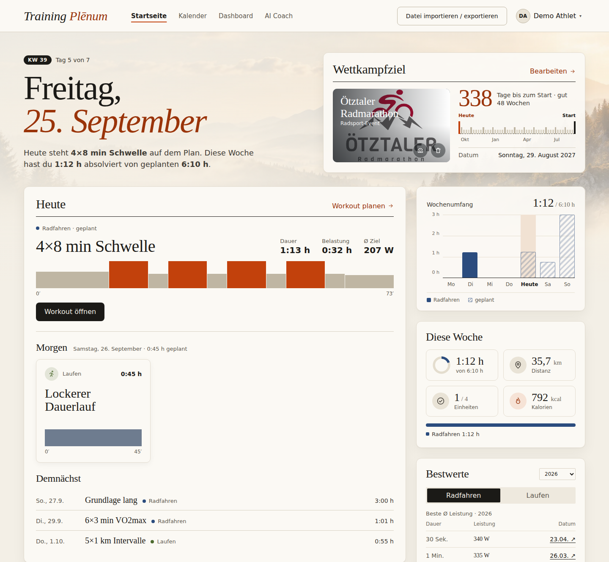
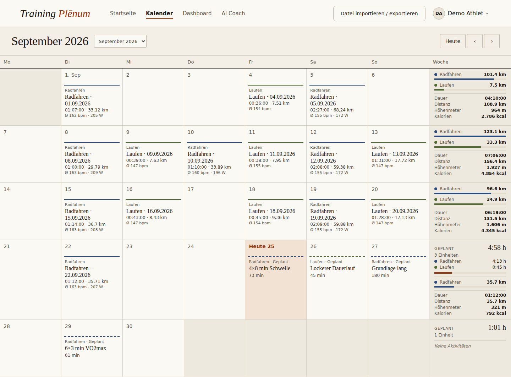
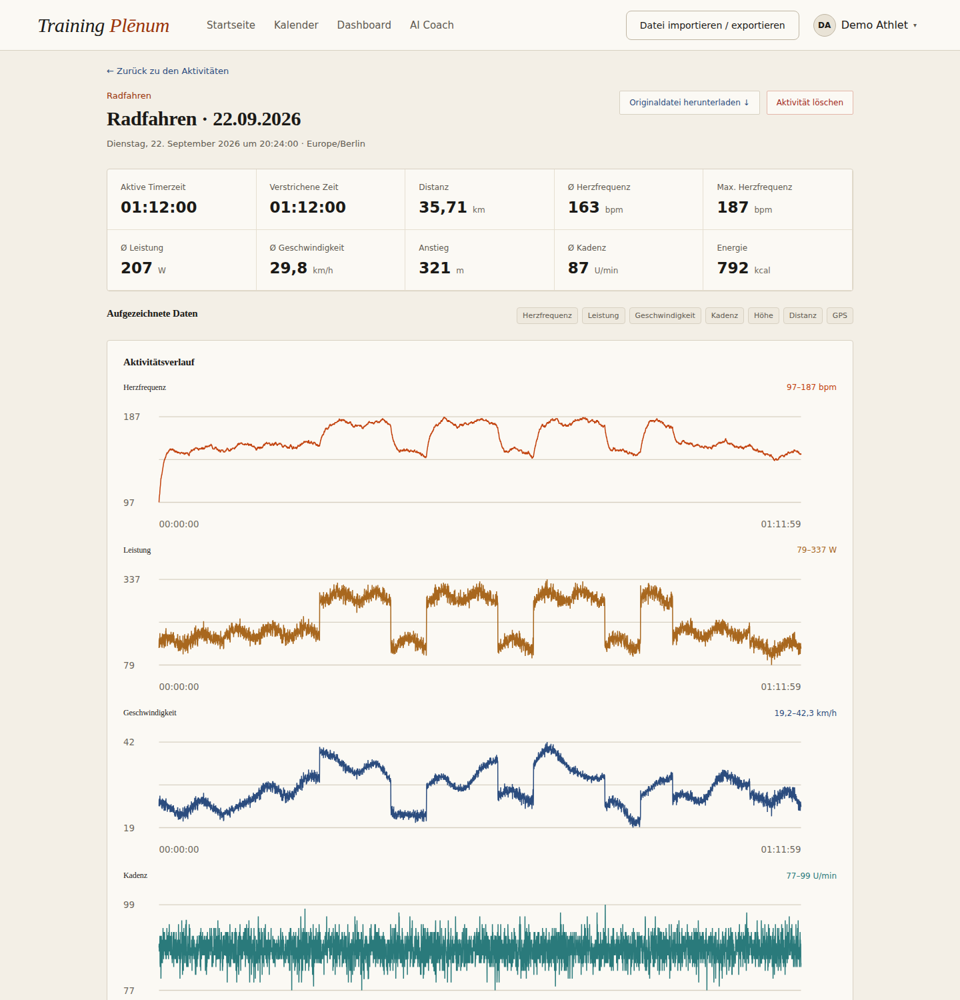
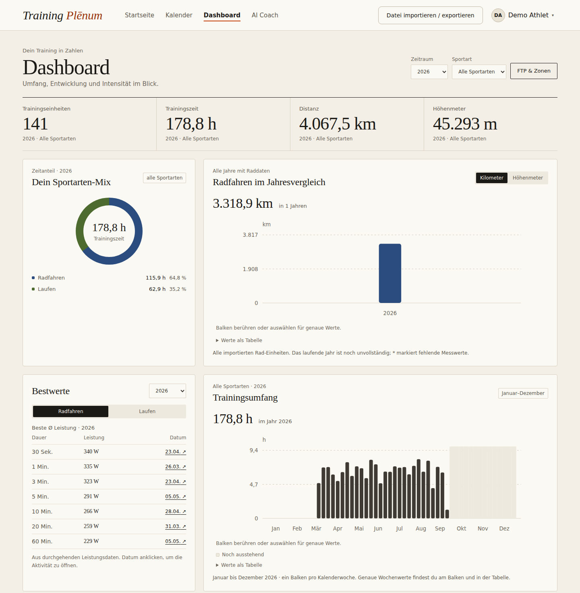
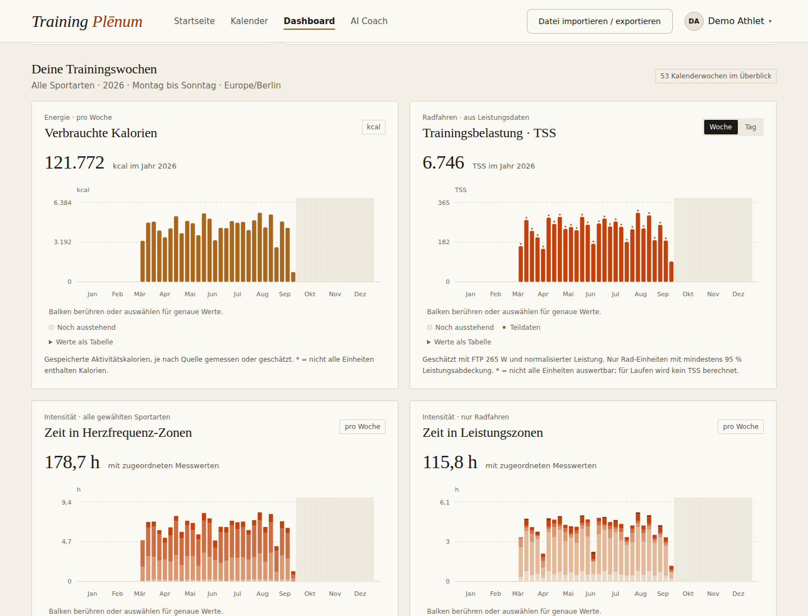
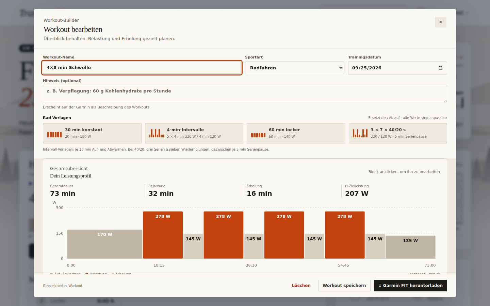
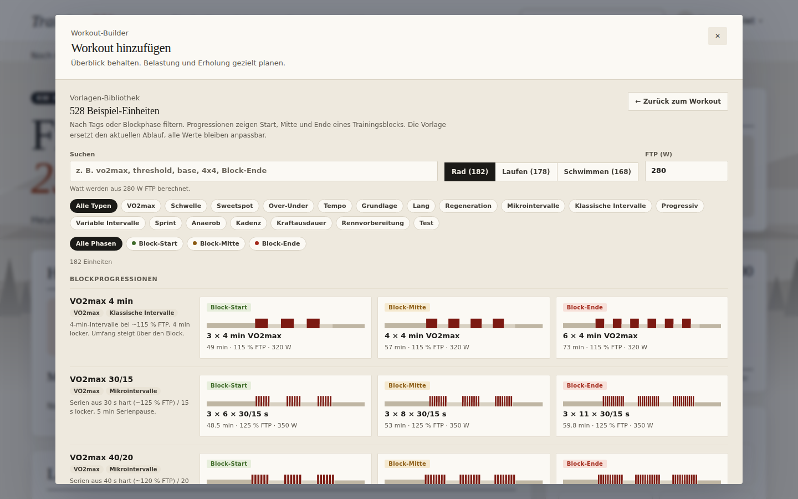
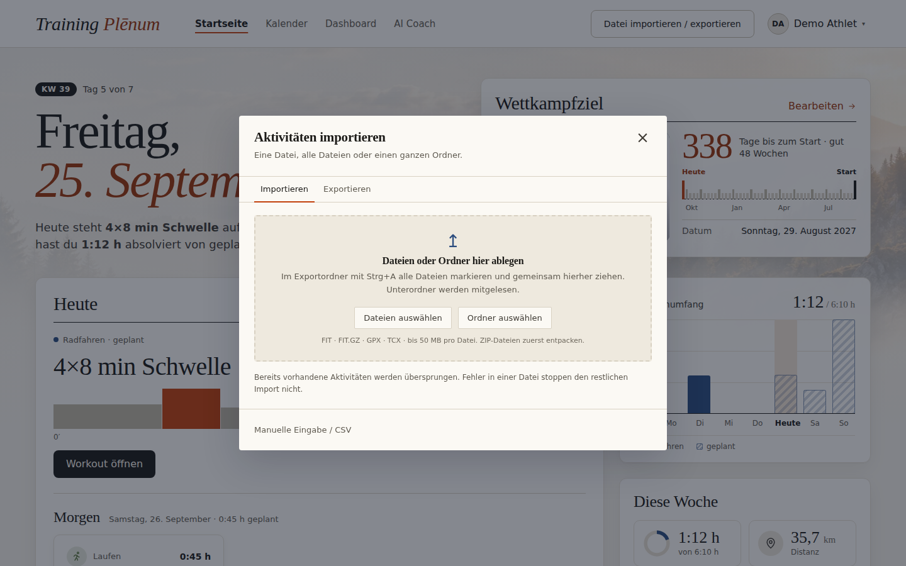
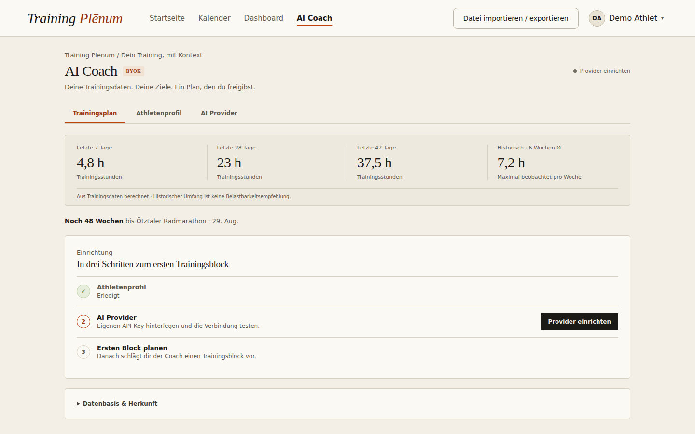

# Training Plēnum — Training Data Platform

**Deine Trainingsdaten, lokal gespeichert und nachvollziehbar ausgewertet.**
Training Plēnum ist eine selbst gehostete Trainingsplattform für Radfahren und Laufen. Importiere FIT-Dateien, analysiere Leistung, Puls und Pace, plane strukturierte Workouts (auf Wunsch KI-gestützt) und exportiere sie als FIT-Datei für deinen Garmin. Kein Abo, kein Cloud-Zwang, und die Daten gehören dir. Der optionale KI-Coach plant mit deinem eigenen OpenAI-Key ganze Trainingsblöcke passend zu Ziel und verfügbarer Zeit; übernommen wird nur, was du bestätigst, und deine Rohdaten verlassen nie den Rechner.

## Warum Training Plēnum?

| Vorteil | Was das konkret bedeutet |
|---------|--------------------------|
| 🔒 **Deine Daten bleiben bei dir** | Läuft auf deinem Rechner, per Windows-Launcher oder Docker. Datenbank und Originaldateien liegen auf deiner Festplatte. Tracks und FIT-Dateien gehen an keinen Kartendienst, die Route wird im Browser gezeichnet. |
| 🤖 **KI-Coach, aber du entscheidest** | Optional plant ein KI-Coach ganze Trainingsblöcke und Wochen nach Ziel, verfügbarer Zeit und deinen Check-ins, mit deinem eigenen OpenAI-Key. Übernommen wird nur, was du bestätigst. Fixierte Einheiten bleiben unangetastet, und Rohdaten verlassen nie den Rechner. |
| 📚 **Über 500 Workout-Vorlagen** | Mehr als 500 fertige Einheiten für Rad, Lauf und Schwimmen, von Grundlage, Sweetspot und Schwelle bis VO2max, Mikrointervalle und Tests, viele als Steigerung über Block-Start, -Mitte und -Ende. Nach Stichwort, Trainingsart und Blockphase durchsuchbar; Watt- und Pulsziele passen sich an deine FTP und maximale HF an. Eigene Workouts lassen sich als Vorlage dazu speichern. Selbst auswählen oder vom KI-Coach passende Einheiten planen lassen. |
| 📦 **Umzug von TrainingPeaks oder Garmin Connect in Minuten** | Den entpackten Export als ganzen Ordner per Drag & Drop importieren. FIT, FIT.GZ, GPX und TCX werden nacheinander verarbeitet, Duplikate übersprungen und fehlerhafte Dateien einzeln gemeldet, ohne dass der Import abbricht. |
| 📈 **Die Kennzahlen, die du kennst** | Bestwerte (Leistung 30 s bis 60 min, Laufzeiten 400 m bis 21 km), Normalized Power und TSS, Zeit in HF- und Leistungszonen, Wochenumfänge, Sportarten-Mix und Jahresvergleiche. Jedes Diagramm zeigt exakte Werte und eine aufklappbare Tabelle. |
| ⚡ **Schnell, auch mit Jahren an Daten** | Berechnungen werden pro Aktivität zwischengespeichert. Filter und Jahreswechsel reagieren sofort. Nach einer FTP-Änderung werden nur die Zonen neu berechnet, ohne alle Dateien erneut einzulesen. |
| 📱 **Von unterwegs und mit Claude** | Über [Tailscale](https://tailscale.com) öffnest du Training Plēnum auch auf dem Handy, ohne die App ins Internet zu stellen. Als MCP-Server liefert sie Claude Trainingsdaten (ohne GPS); auf Wunsch plant Claude auch Einheiten. Siehe [Claude & Fernzugriff](CLAUDE-UND-TAILSCALE.md). |
| 🧪 **Nachvollziehbar und getestet** | Alle Formeln sind offen und mit Quellen belegt. Automatische Tests prüfen Backend und Frontend, und jede exportierte FIT-Datei wird vor dem Download noch einmal eingelesen und geprüft. |

### Für wen?

- **Ambitionierte Radfahrer:innen und Läufer:innen**, die ihre Daten besitzen und genau verstehen wollen, wie Kennzahlen entstehen.
- **Umsteiger:innen von TrainingPeaks & Co.**, die ihre komplette Historie mitnehmen möchten.
- **Garmin-Nutzer:innen**, die strukturierte Workouts ohne Umweg über eine Cloud aufs Gerät bringen wollen.

> **Hinweis:** Training Plēnum ist aktuell eine lokale Anwendung für eine:n Athlet:in. Für den Betrieb auf einem entfernten oder geteilten Server fehlen noch Authentifizierung und Härtung (siehe [Geplante Features](#geplante-features-v2)). Für den Zugriff von unterwegs gibt es deshalb [Tailscale](CLAUDE-UND-TAILSCALE.md): Die App bleibt in deinem privaten Netz.

**Schnell loslegen:** [Windows-App](#windows-app) · [Start mit Docker](#mit-docker-empfohlen) · [AI Coach einrichten](AI-COACH.md) · [Claude & Fernzugriff](CLAUDE-UND-TAILSCALE.md)

## So sieht es aus

> Alle Screenshots zeigen erfundene Demo-Daten („Demo Athlet“), keine echten Aufzeichnungen. Zum Vergrößern ein Bild anklicken.

**Startseite:** Datum, Wettkampfziel mit Countdown, das heutige Workout als Leistungsprofil, Wochenumfang, Bestwerte und die letzten Aktivitäten.

[](docs/screenshots/startseite.png)

<table>
  <tr>
    <td width="50%"><a href="docs/screenshots/kalender.png"></a><br><b>Kalender:</b> absolvierte und geplante Einheiten (gestrichelt), rechts die Wochensummen je Sportart. Geplante Workouts lassen sich per Drag &amp; Drop verschieben.</td>
    <td width="50%"><a href="docs/screenshots/aktivitaet.png"></a><br><b>Aktivität:</b> Kennzahlen, erkannte Sensoren und der komplette Verlauf von Puls, Leistung, Tempo, Kadenz und Höhe. Darüber liegt die interaktive Karte.</td>
  </tr>
  <tr>
    <td><a href="docs/screenshots/dashboard.png"></a><br><b>Dashboard:</b> Jahreszahlen, Sportarten-Mix, Jahresvergleich, Bestwerte und der Wochenumfang.</td>
    <td><a href="docs/screenshots/dashboard-wochen.png"></a><br><b>Trainingswochen:</b> Kalorien, TSS sowie die Zeit in Herzfrequenz- und Leistungszonen pro Woche.</td>
  </tr>
  <tr>
    <td><a href="docs/screenshots/workout-editor.png"></a><br><b>Workout-Editor:</b> Vorlagen, Intervalle mit Watt-/Pace-/HF-Zielen und die Gesamtübersicht. Direkt als Garmin-FIT-Datei exportierbar.</td>
    <td><a href="docs/screenshots/workout-vorlagen.png"></a><br><b>Workout-Vorlagen:</b> über 500 Einheiten für Rad, Lauf und Schwimmen, filterbar nach Trainingsart und Blockphase. Progressionen zeigen Start, Mitte und Ende eines Trainingsblocks.</td>
  </tr>
  <tr>
    <td><a href="docs/screenshots/import.png"></a><br><b>Import:</b> einzelne Dateien oder einen ganzen Exportordner per Drag &amp; Drop übernehmen.</td>
    <td><a href="docs/screenshots/ai-coach.png"></a><br><b>AI Coach:</b> Überblick über die letzten Wochen und in drei Schritten zum ersten Trainingsblock (Athletenprofil, eigener API-Key, Block planen).</td>
  </tr>
</table>


## Aktivitäten importieren

Alles rund um Daten liegt an einer Stelle: Oben rechts auf **Daten** klicken. Daneben steht, wann Garmin Connect zuletzt abgeglichen hat. Der Dialog **Daten & Geräte** zeigt alle Wege, Aktivitäten zu holen und Workouts aufs Gerät zu bringen, und darunter die zuletzt importierten Aktivitäten mit ihrer Herkunft.

| Weg | Wann | So geht's |
|-----|------|-----------|
| **Garmin Connect** | Laufend, ohne Kabel | Einmal verbinden, danach kommen neue Aktivitäten automatisch. **Jetzt abgleichen** holt sie sofort. Siehe [Garmin Connect](#garmin-connect). |
| **Garmin per USB** | Ohne Garmin-Konto oder offline | Garmin anschließen, **Garmin-Ordner wählen** und den Ordner `GARMIN` auf dem Gerät wählen. Gelesen wird nur `GARMIN/Activity`, der Import startet sofort. In Chrome und Edge merkt sich Training Plēnum den Ordner; beim nächsten Mal reicht **Erneut einlesen**. Auf dem Gerät sind meist nur die letzten Aktivitäten gespeichert. |
| **Dateien & Exporte** | Einzelne Dateien oder die komplette Historie | Dateien oder einen ganzen Ordner ins Fenster ziehen, oder **Dateien auswählen** bzw. **Ordner auswählen**. Unterordner werden mitgelesen. Dann auf **Dateien importieren** klicken. |
| **Manuell eintragen** | Einheiten ohne Aufzeichnung | Sportart, Datum, Startzeit und Dauer eingeben, optional Distanz, Puls und Notizen. |

Gelesen werden **FIT**, **FIT.GZ**, **GPX** und **TCX**. Die Originaldatei bleibt erhalten, jeder Messpunkt wird gespeichert. Dateien lassen sich auch einfach irgendwo ins Fenster ziehen.

**Woher kommen Exporte?**

- **Garmin Connect (komplette Historie):** Im Garmin-Konto unter **Datenverwaltung** den Datenexport anfordern. Der Download-Link kommt per E-Mail. Die ZIP-Datei entpacken und darin auch die weiteren ZIPs mit den Aktivitäten.
- **TrainingPeaks:** Export herunterladen und entpacken.
- **Strava:** Datenexport anfordern, entpacken und den Ordner `activities` importieren (FIT- und GPX-Dateien).
- **Garmin-Gerät, das nicht als Laufwerk erscheint:** Den Ordner `GARMIN/Activity` zuerst auf den Rechner kopieren (auf dem Mac z. B. mit OpenMTP) und die Kopie unter **Garmin per USB** wählen.

**Gut zu wissen:**

- **ZIP-Dateien zuerst entpacken.** Direkt lesen kann Training Plēnum nur die entpackten Dateien.
- **Doppelte Dateien** werden erkannt und als **schon vorhanden** übersprungen, egal über welchen Weg sie kommen. Denselben Ordner oder dasselbe Gerät nochmal einzulesen schadet also nicht.
- **Eine kaputte Datei** stoppt den Import nicht. Sie wird in der Liste als Fehler angezeigt und lässt sich mit **Fehler erneut versuchen** nochmal probieren.
- **Anhalten:** **Nach aktueller Datei stoppen** beendet den Import sauber. Bereits importierte Aktivitäten bleiben gespeichert.
- **Tab offen lassen**, solange der Import läuft.

Eine Aktivität löschen: Aktivität öffnen, **Aktivität löschen** und dann **Endgültig löschen** klicken.

## Aktivität ansehen

Ein Klick auf eine Aktivität zeigt Kennzahlen, erkannte Sensoren und den Verlauf von Puls, Leistung, Tempo, Kadenz und Höhe.

**Karte:** Hat die Aktivität GPS, erscheint die Route auf einer OpenStreetMap-Karte. Fährst du mit der Maus über ein Diagramm, springt der Punkt auf der Karte an dieselbe Stelle und zeigt Distanz, Tempo, Puls und Watt.

Die Route wird in deinem Browser gezeichnet. An OpenStreetMap gehen nur die Anfragen für die Kartenbilder des sichtbaren Ausschnitts, nie deine Tracks oder FIT-Dateien. Für die Karte braucht es daher Internet. Einen anderen Kartendienst kannst du über `REACT_APP_MAP_TILE_URL` einstellen (dann die Quellenangabe in `RouteMap.jsx` anpassen).

## Bestwerte

Auf der **Startseite** zeigt die Karte **Bestwerte** deine besten Leistungen, wahlweise für **Radfahren** oder **Laufen** und für ein Jahr oder **All-Time**. Ein Klick aufs Datum öffnet die passende Aktivität.

- **Rad:** höchste Durchschnittsleistung über 30 s sowie 1, 3, 5, 10, 20 und 60 min.
- **Laufen:** schnellste Zeit über 400 m, 1 km, 5 km, 10 km und 21 km.

Es zählen nur echte, zusammenhängende Aufzeichnungen. Lücken über 30 Sekunden, fehlende Werte oder ein Sportwechsel unterbrechen die Suche. Reichen die Daten nicht, steht ein Strich da. Es sind Trainingsbestwerte, keine offiziellen Wettkampfzeiten.

## Dashboard

Ganz oben steht deine **Fitness**: wie fit du heute bist, über alle Sportarten, mit Veränderung und Verlauf für 1 Monat bis 2 Jahre (ähnlich wie bei Strava).

Außerdem zeigt das **Dashboard** für ein Jahr oder **All-Time**:

- Anteil der Sportarten an deiner Trainingszeit
- Rad-Kilometer und Höhenmeter im Jahresvergleich
- Trainingsstunden und Kalorien pro Woche
- TSS pro Woche und pro Tag
- Zeit in Puls- und Leistungszonen pro Woche

Jedes Diagramm zeigt die genauen Werte und hat eine aufklappbare Tabelle. Darunter steht die Liste aller Aktivitäten.

**FTP und maximale Herzfrequenz** trägst du unter **FTP & Zonen** ein. Ohne diese Werte können Fitness, Zonen und TSS nicht berechnet werden.

## Workouts planen und auf den Garmin bringen

**Workout erstellen:**

1. Auf der **Startseite** bei **Heute** oder **Morgen** auf **Workout hinzufügen** klicken, oder im **Kalender** bei einem Tag auf **+**.
2. Sportart wählen und Schritte bauen: Aufwärmen, Intervalle mit Pause, Erholung, Abwärmen. Ziele gehen nach Watt, Pace, Tempo, Puls oder Kadenz.
3. Oder eine fertige Einheit aus der **Vorlagen-Bibliothek** übernehmen (über 500 Vorlagen). Alle Werte bleiben änderbar.
4. **Workout speichern**. Es erscheint dann im Kalender.
5. Optional **Als Vorlage speichern**: Das Workout landet ohne Datum in der Vorlagen-Bibliothek unter **Meine Vorlagen** und lässt sich dort an jedem Tag wieder übernehmen oder löschen.

Die **Gesamtübersicht** unten im Editor zeigt das ganze Workout als Leistungsprofil mit Dauer, Belastung und Erholung. Ein Klick auf einen Block springt direkt zu seinen Einstellungen.

**Im Kalender verschieben:** Geplante Workouts einfach per Drag & Drop auf einen anderen Tag ziehen.

**Auf den Garmin bringen:**

1. Im Editor auf **Garmin FIT herunterladen** klicken. Mehrere Workouts auf einmal: unter **Daten → Per USB als FIT-Datei** auswählen (z. B. **Nächste 7 Tage**) und als ZIP herunterladen.
2. Garmin per USB anschließen und die `.fit`-Datei(en) in den Ordner `GARMIN/NewFiles` kopieren (ZIP vorher entpacken).
3. Garmin sicher auswerfen. Das Workout findest du im Trainingsmenü des Geräts. Das Datum steht im Namen, z. B. `24.09.2026 · 30 min konstant`.

Mit verbundenem [Garmin Connect](#garmin-connect) geht es auch ohne Kabel: Geplante Einheiten landen dann automatisch im Garmin-Kalender.

Getestet auf dem Edge 1050. Welche Ziele und Funktionen unterstützt werden, hängt vom Gerät ab. Es entsteht kein Eintrag im Garmin-Kalender, nur ein Workout auf dem Gerät. Mehr dazu in [Garmins Anleitung](https://support.garmin.com/en-GB/?faq=AXV7LuWgc73v21nq6nbDa6).

## Garmin Connect

Training Plēnum holt neue Aktivitäten selbst aus Garmin Connect, als originale FIT-Datei mit allen Messpunkten, und schickt geplante Einheiten in deinen Garmin-Kalender. Kostenlos, aber über die **inoffizielle** Schnittstelle (Bibliothek [garminconnect](https://github.com/cyberjunky/python-garminconnect)), denn Garmin bietet für private Nutzer keine offizielle API an. Ändert Garmin den Login, kann der Abgleich vorübergehend ausfallen; Datei- und USB-Import funktionieren weiter.

1. Oben rechts auf **Daten** klicken und bei **Garmin Connect** auf **Verbinden** (oder im Menü unter deinem Namen **Garmin Connect verbinden**).
2. E-Mail und Passwort des Garmin-Kontos eingeben. Ist die Zwei-Faktor-Anmeldung aktiv, danach den Code von Garmin eingeben.
3. Der erste Abgleich holt die letzten 90 Tage, danach läuft er beim Start und alle 6 Stunden (`GARMIN_SYNC_INTERVAL_HOURS`, `0` schaltet ihn ab) oder per **Jetzt synchronisieren**.
4. Optional: Unter **Ältere Aktivitäten nachladen** 1, 2, 3 oder 5 Jahre oder **Alles** wählen und **Nachladen** klicken.

- **Ältere Aktivitäten** kommen in Etappen von etwa einem Monat, rückwärts und mit einer Sekunde Pause zwischen den Downloads, damit Garmin nicht bremst. Abgleich und Workouts laufen zwischen den Etappen weiter, der Dialog darf zu. Der Fortschritt wird gespeichert: Nach **Anhalten**, einem Neustart oder wenn Garmin „zu viele Anfragen“ meldet, macht **Fortsetzen** an derselben Stelle weiter. Ein größerer Zeitraum setzt unterhalb des schon geprüften an. Für sehr lange Historien ist der Garmin-Datenexport (siehe [Aktivitäten importieren](#aktivitäten-importieren)) die Alternative ohne Last auf der Schnittstelle.

- **Geplante Einheiten ab heute** landen als strukturiertes Workout (Watt, Pace, Puls, Kadenz, Wiederholungen) am geplanten Tag im Garmin-Connect-Kalender; Garmin überträgt sie wie gewohnt aufs Gerät (**Training → Kalender**). Neu planen, Verschieben, Ändern und Löschen in Training Plēnum, im Kalender oder durch den KI-Coach werden sofort übernommen. Vergangene Einheiten bleiben in Garmin stehen. Änderungen direkt in Garmin Connect kommen nicht zurück.
- **Nur eigene Workouts:** Training Plēnum ändert oder löscht in Garmin nur, was es selbst angelegt hat. Beim Abschalten des Sendens oder beim Trennen lassen sich diese Workouts auf Wunsch wieder aus Garmin löschen.
- **Doppelte Aktivitäten** werden übersprungen: gleiche Datei oder gleiche Startzeit (±2 min), etwa aus einem früheren TrainingPeaks-Export.
- **Das Passwort wird nicht gespeichert.** Nur der Anmelde-Token bleibt, verschlüsselt mit demselben Schlüssel wie der API-Key des KI-Coachs (`.run/ai-encryption-key.txt`). **Trennen** löscht die Anmeldung, importierte Aktivitäten bleiben.
- Braucht **Python 3.12 oder neuer** (im Docker-Image enthalten).

## KI-Coach

Der KI-Coach plant auf Wunsch ganze Trainingsblöcke und Wochen nach deinem Ziel, deiner verfügbaren Zeit und deinen Check-ins. Du brauchst dafür einen eigenen OpenAI-API-Key.

- Nichts wird übernommen, bevor du es bestätigst.
- Fixierte Einheiten bleiben unangetastet.
- Deine Rohdaten (Sensorverläufe, FIT-Dateien) verlassen nie den Rechner. An OpenAI geht nur eine kompakte Zusammenfassung.

Der API-Key wird verschlüsselt gespeichert. Den Schlüssel dafür legt das Programm beim ersten Start in `.run/ai-encryption-key.txt` an. **Diese Datei getrennt von der Datenbank sichern**, sonst ist der gespeicherte API-Key nach einer Wiederherstellung nicht mehr lesbar.

Alle Details zur Einrichtung: [AI-COACH.md](AI-COACH.md)

## Von unterwegs und mit Claude

Im Menü oben rechts (dein Name) unter **Claude & Fernzugriff** steht alles, was dafür nötig ist: der Tailscale-Status, die Befehle zum Kopieren, das Token und der Freigabecode.

- **Von unterwegs:** Tailscale auf Rechner und Handy installieren, einmal `tailscale serve --bg 5000` (Windows-App) oder `tailscale serve --bg 80` (Docker) ausführen und auf dem Handy `https://<rechner>.<tailnet>.ts.net` öffnen. Die App ist nur in deinem Tailnet sichtbar.
- **Claude Code und Claude Desktop** verbinden sich mit einem Token, das im Dialog erzeugt wird. Der Dialog zeigt dazu den fertigen Befehl bzw. die Konfiguration.
- **claude.ai und die Claude-App auf dem Handy** verbinden sich aus der Cloud von Anthropic. Dafür kommt per `tailscale funnel --bg --https=8443 5001` nur der Claude-Port ins Internet, der ausschließlich MCP und die Anmeldung beantwortet. Die Verbindung bestätigst du mit einem Freigabecode aus der App.
- Claude darf standardmäßig **nur lesen**. „Lesen und Einheiten planen“ erlaubt zusätzlich, Workouts anzulegen, zu ändern und zu löschen. GPS-Positionen gehen nie an Claude.

Einrichtung, Sicherheit, Docker und Fehlersuche: [CLAUDE-UND-TAILSCALE.md](CLAUDE-UND-TAILSCALE.md)

## WHOOP 4.0 (in Arbeit)

Training Plēnum liest einen **WHOOP 4.0** direkt aus, ohne WHOOP-App. Eine kleine Bridge auf dem Mac hält die Bluetooth-Verbindung und schickt die Rohdaten an Training Plēnum; Einrichtung und Status findest du im Menü oben rechts unter **WHOOP-Strap verbinden**.

- **Stand (Phase 2):** Herzfrequenz, R-R-Abstände und Bewegung kommen an. Daraus berechnet Training Plēnum pro Tag Schlafdauer, nächtliche HRV (RMSSD), Ruhepuls, eine Readiness von 0 bis 100 gegenüber deiner persönlichen Baseline, Strain (0–21) und Schlafschuld. Die Readiness erscheint nach 4 Nächten (vorläufig) und ist ab 14 Nächten verlässlich. Die Werte stehen auf der Startseite (Kachel **Erholung** und ein Hinweis, wenn eine harte Einheit auf einen schlechten Erholungstag fällt), im Kalender (Punkt und Readiness je Tag, Wochenmittel) und im Dashboard (HRV mit Normalbereich und Readiness auf derselben Zeitachse wie die Fitness). Der KI-Coach folgt.
- Alle Werte sind eigene Näherungen, keine offiziellen WHOOP-Scores und kein Medizinprodukt. Methoden: [RESEARCH-ANALYTICS.md](docs/whoop-integration/RESEARCH-ANALYTICS.md).
- Der Strap muss dafür von der WHOOP-App getrennt werden. Danach erhalten WHOOP-App und WHOOP-Cloud keine Daten mehr.
- Die Rohdaten jedes Uploads bleiben 30 Tage erhalten (`WHOOP_RAW_RETENTION_DAYS`), damit Decoder-Korrekturen per **Rohdaten neu einlesen** nachträglich greifen.

Einrichtung und Fehlersuche: [whoop-bridge/README.md](whoop-bridge/README.md). Plan und Protokoll-Recherche: [docs/whoop-integration/](docs/whoop-integration/).

## Startseite anpassen

Im Menü oben rechts (dein Name) unter **Hintergrund** wählst du **Landschaft**, ein eigenes **Foto** (JPEG, PNG oder WebP bis 10 MB) oder **Aus**. Die Wettkampfziel-Karte hat ein eigenes Foto: Kamera-Symbol zum Hinzufügen, Mülleimer zum Entfernen. Fotos bleiben auf deinem Rechner.

## Installation

### Windows-App

Am einfachsten: `TrainingPlenum-Setup-<Version>.exe` von der [Releases-Seite](../../releases) laden und ausführen. Admin-Rechte sind nicht nötig. Danach startet Training Plēnum über das Startmenü in einem eigenen Fenster, ohne Python, Node.js oder Browser-Tab.

- **Daten** liegen in `%LOCALAPPDATA%\Training Plenum`: Datenbank, Originaldateien, der AI-Key-Schlüssel (`data\ai-encryption-key.txt`) und ein Log der letzten Sitzung. Updates und Deinstallieren lassen sie stehen. Zum Sichern diesen Ordner kopieren.
- **Update:** neuen Installer einfach drüber installieren.
- **Voraussetzung:** Windows 10 oder 11 (64 Bit) mit der Microsoft Edge WebView2-Runtime, die dort normalerweise schon installiert ist. Die App nutzt Port 5000 auf `127.0.0.1`; die Version per `start-local.ps1` darf nicht gleichzeitig laufen.
- **Bisherige Daten übernehmen** (vorher per `start-local.ps1` genutzt): beide Versionen beenden, dann nach `%LOCALAPPDATA%\Training Plenum` kopieren: `backend\data\trainhub.db` und `.run\ai-encryption-key.txt` in den Unterordner `data`, den Inhalt von `backend\uploads` in den Unterordner `uploads`.
- Windows SmartScreen kann beim ersten Start warnen, weil der Installer nicht signiert ist: **Weitere Informationen → Trotzdem ausführen**.

**Installer selbst bauen** (Python 3.12, Node.js und [Inno Setup 6](https://jrsoftware.org/isdl.php)): `.\desktop\build-windows.ps1 -Version 1.2.3`, das Ergebnis liegt in `dist/`. GitHub Actions baut ihn bei jedem Tag wie `v1.2.3` oder `1.2.3` und hängt ihn an das Release; für ein schon bestehendes Release den Workflow „Windows-App“ von Hand mit dem Tag als „release“ starten (`.github/workflows/windows-app.yml`).

### Start unter Windows (aus dem Quellcode)

**Einmalig einrichten** (im Projektordner, mit Python 3.12 oder neuer für Garmin Connect):

```powershell
python -m venv backend/.venv
backend/.venv/Scripts/python.exe -m pip install -r backend/requirements.txt
cd frontend
npm install
npm run build
cd ..
```

**Starten:**

```powershell
.\start-local.ps1
```

Dann im Browser http://localhost:3000 öffnen. Die Server laufen unsichtbar im Hintergrund; Logs und Prozess-IDs liegen in `.run/`. Beenden mit `Stop-Process -Id <ID>`. Ist ein Port schon belegt, zuerst das andere Programm beenden.

Nach Änderungen an der Oberfläche in `frontend` erneut `npm run build` ausführen.

### Mit Docker (empfohlen)

```bash
docker-compose up --build
```

Danach im Browser öffnen:

- App: http://localhost:3000
- API: http://localhost:5000/api/health

### Ohne Docker (Linux/macOS)

```bash
# Backend
cd backend
python -m venv venv
source venv/bin/activate
pip install -r requirements.txt
python app.py            # läuft auf http://localhost:5000

# Frontend (zweites Terminal)
cd frontend
npm install
npm start                # läuft auf http://localhost:3000
```

## Wie wird gerechnet?

Alle Formeln sind offen im Code nachlesbar. Die wichtigsten:

- **Normalized Power (NP):** berechnet aus dem gleitenden 30-Sekunden-Durchschnitt der Leistung, nach der [Methode von TrainingPeaks](https://help.trainingpeaks.com/hc/en-us/articles/204071804-Normalized-Power).
- **TSS (Rad):** `Stunden × (NP / FTP)² × 100`. Nur für Radfahrten, bei denen fast die ganze Zeit Leistung aufgezeichnet wurde. Sonst bleibt der Wert leer statt geschätzt.
- **Fitness (CTL):** über 42 Tage gewichteter Durchschnitt der Tagesbelastung: `Fitness heute = Fitness gestern + (Belastung heute − Fitness gestern) / 42`. Belastung ist der Leistungs-TSS einer Radfahrt, sonst ein Puls-TSS: `Stunden × (Puls / Schwellen-HF)² × 100` mit Schwellen-HF = 90 % der HFmax. Einheiten, bei denen der Puls weniger als die halbe Zeit aufgezeichnet wurde, zählen nicht.
- **Pulszonen (5):** Grenzen bei 60, 70, 80 und 90 % der maximalen Herzfrequenz.
- **Leistungszonen (7):** Grenzen bei 55, 75, 90, 105, 120 und 150 % der FTP.
- **Lücken:** Fehlende Werte werden nie als Null gezählt. Lücken über 30 Sekunden und Sportwechsel trennen die Daten.
- **Wochen** beginnen am Montag, Datumsangaben richten sich nach der Zeitzone deines Browsers.

Berechnungen werden pro Aktivität zwischengespeichert. Deshalb sind Filter schnell, und nach einer FTP-Änderung werden nur die Zonen neu eingeteilt.

## Für Entwickler

**Tests ausführen:**

```powershell
cd backend
.venv/Scripts/python.exe -m unittest -v
cd ../whoop-bridge
python -m unittest -v
cd ../frontend
npm test -- --watchAll=false --runInBand
npm run build
```

Die Tests nutzen eine temporäre Datenbank und verändern keine eigenen Aktivitäten.

**Speicherorte:** Datenbank und Uploads liegen standardmäßig in `backend/data` und `backend/uploads`. Mit `DATABASE_URL` und `UPLOAD_FOLDER` lassen sie sich ändern. Beim Start ergänzt das Backend fehlende Tabellen und Spalten, ohne vorhandene Daten zu ersetzen. Persönliche Aufzeichnungen und Datenbanken sind von Git ausgeschlossen.

**Technik:** React 18 (Frontend), Python Flask (Backend), SQLite (Datenbank), fitparse, gpxpy und lxml (Dateien lesen), Garmin FIT SDK (Workout-Export), Docker Compose und Nginx.

**Workout-Export:** `backend/workout_export.py` erzeugt die FIT-Datei mit dem offiziellen [Garmin FIT SDK](https://github.com/garmin/fit-python-sdk). Jede Datei wird vor dem Download erneut eingelesen und auf Schritte, Wiederholungen und Zielwerte geprüft.

**Wichtige API-Endpunkte:**

| Methode | Endpunkt | Zweck |
|---------|----------|-------|
| GET | `/api/health` | Läuft der Server? |
| GET / PUT | `/api/user` | Profil, FTP und max. Herzfrequenz |
| GET | `/api/activities` | Alle Aktivitäten |
| GET / PUT / DELETE | `/api/activities/:id` | Eine Aktivität ansehen, ändern, löschen |
| POST | `/api/upload` | Datei hochladen |
| POST | `/api/activities/manual` | Aktivität von Hand anlegen |
| GET | `/api/analytics` | Daten für das Dashboard |
| GET | `/api/best-efforts` | Bestwerte |
| GET / POST | `/api/workouts` | Geplante Workouts |
| PUT / DELETE | `/api/workouts/:id` | Workout ändern oder löschen |
| POST | `/api/workouts/export` | Workout als Garmin-FIT-Datei |

| GET / DELETE | `/api/whoop` | WHOOP-Status; trennen (`?deleteData=1` löscht auch die Daten) |
| POST | `/api/whoop/token` | Bridge-Token erzeugen oder erneuern (wird nur einmal angezeigt) |
| POST | `/api/whoop/sync` | Bridge um sofortigen Sync bitten |
| POST | `/api/whoop/recompute` | Rohdaten neu dekodieren und alle Tage neu berechnen |
| GET | `/api/whoop/days?from=&to=` | Tageswerte: Schlaf, HRV, Ruhepuls, Readiness, Strain, Schlafschuld |
| POST | `/api/whoop/bridge/heartbeat`, `/api/whoop/bridge/frames` | Nur für die Bridge (Bearer-Token) |
| GET / DELETE | `/api/garmin` | Garmin-Status; trennen (Aktivitäten bleiben, `?deleteWorkouts=1` löscht gesendete Workouts aus Garmin) |
| POST | `/api/garmin/login`, `/api/garmin/mfa` | Mit Garmin anmelden, ggf. Zwei-Faktor-Code bestätigen |
| POST | `/api/garmin/sync` | Abgleich sofort starten (Aktivitäten holen, Einheiten senden) |
| PUT | `/api/garmin/settings` | Senden geplanter Einheiten an/aus (`removeWorkouts` löscht gesendete) |
| POST | `/mcp` | MCP-Server für Claude (Streamable HTTP, Bearer-Token oder OAuth) |
| GET | `/api/mcp` | Claude-Zugang: Token-Status, Schreibrecht, verbundene Apps |
| POST / DELETE | `/api/mcp/token` | Persönliches Token erzeugen (wird nur einmal angezeigt) oder löschen |
| PUT | `/api/mcp/settings` | `allowWrite`: Claude darf Einheiten planen |
| POST | `/api/mcp/pairing` | Freigabecode für die Anmeldung der Claude-Apps (10 min, einmal) |
| DELETE | `/api/mcp/connections[/:id]` | Verbundene Claude-Apps trennen |
| GET | `/api/remote-access` | Tailscale-Status, Freigaben und Befehle (`?refresh=1` prüft neu) |
| GET / POST | `/.well-known/oauth-*`, `/oauth/register`, `/oauth/authorize`, `/oauth/token` | OAuth 2.1 für Claudes Connectors |

Die Endpunkte des KI-Coachs stehen in [AI-COACH.md](AI-COACH.md).

## Geplante Features (v2+)

- [ ] Fitness / Ermüdung / Form (CTL/ATL/TSB)
- [ ] Coach-Accounts mit Zugriff auf Athleten
- [ ] Erweiterte Analysen (Leistungskurve, Zonentabellen)
- [x] Garmin Connect (Aktivitäten abholen, geplante Einheiten in den Garmin-Kalender)
- [ ] Strava-Anbindung
- [ ] WHOOP 4.0: Rohdaten per Bridge ✓, Erholung/HRV/Schlaf/Belastung ✓, Planungshinweise ✓, Coach-Kontext
- [x] TSS fürs Radfahren mit einstellbarer FTP (TSS fürs Laufen folgt)
- [ ] Trainingsplan-Builder
- [ ] Benutzeranmeldung (JWT)
- [ ] PostgreSQL für den Produktivbetrieb
- [ ] DSGVO-konforme Datenverwaltung

## Lizenz

[MIT](LICENSE): Du darfst Training Plēnum kostenlos nutzen, verändern und weitergeben, auch kommerziell, solange der Lizenzhinweis erhalten bleibt. Verwendete Bibliotheken wie das Garmin FIT SDK stehen unter ihren eigenen Lizenzen.
